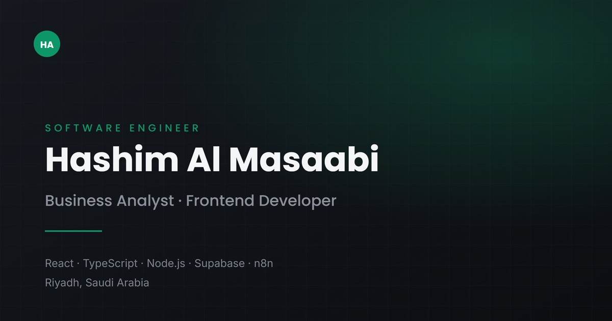

<div align="center">

# Hashim Al Masaabi — Personal Website

**Software Engineer & Business Analyst · Riyadh, Saudi Arabia**

[](https://hashim-almasaabi.netlify.app)
[](https://www.linkedin.com/in/hashim-almasaabi-b51ba4353/)




</div>

## Overview

A bilingual (English / Arabic) portfolio presenting my services, selected projects,
experience, and skills. Built as a fast, static single-page app with full RTL support,
light and dark themes, and motion that respects accessibility preferences.

## Features

- **Bilingual with true RTL** — English and Arabic from typed dictionaries; the layout mirrors, not just the text.
- **Light & dark themes** — saved per visitor and applied before first paint, so there is no flash.
- **Smooth, accessible motion** — Framer Motion + Lenis, fully disabled under `prefers-reduced-motion`.
- **Performance-minded** — code-split below-the-fold content, responsive WebP images, preloaded hero portrait.
- **Share-ready** — Open Graph and Twitter card metadata with absolute URLs for rich link previews.
- **Responsive** — tested from 320 px phones up to 2560 px displays.

## Tech Stack

| Layer      | Choice                                      |
| ---------- | ------------------------------------------- |
| Framework  | React 18 + TypeScript                       |
| Build      | Vite 6                                      |
| Styling    | Tailwind CSS v4 (design tokens in `index.css`) |
| Motion     | Framer Motion                               |
| Scrolling  | Lenis                                       |
| Icons      | lucide-react + custom SVG marks             |

## Getting Started

```bash
git clone https://github.com/Hashim0011/personal-website.git
cd personal-website
npm install
cp .env.example .env
npm run dev       # http://localhost:5173
```

| Script            | Description                          |
| ----------------- | ------------------------------------ |
| `npm run dev`     | Start the development server         |
| `npm run build`   | Type-check and build to `dist/`      |
| `npm run preview` | Serve the production build locally   |

## Project Structure

```
src/
├── components/        # Page sections (Hero, Services, Portfolio, Resume, Skills, Contact…)
│   └── ui/            # Reusable pieces (Reveal, Magnetic, ThemeToggle, LanguageToggle…)
├── hooks/             # useTheme, useActiveSection, useSmoothScroll
├── i18n/              # en.ts / ar.ts dictionaries + LocaleProvider
├── lib/               # Motion feature loading, URL flags
└── index.css          # Tailwind theme tokens
public/                # Portrait, project screenshots, fonts, OG image
```

## Editing Content

All copy lives in [`src/i18n/en.ts`](src/i18n/en.ts) and [`src/i18n/ar.ts`](src/i18n/ar.ts)
— profile, services, projects, experience, skills, and navigation. Both dictionaries share
one type, so a missing translation is a compile error.

Project screenshots go in [`public/projects/`](public/projects/) as 1400 × 1050 WebP files.
The brand colour is `--color-brand-500` in [`src/index.css`](src/index.css).

## Deployment

`npm run build` outputs a static `dist/` folder, deployable to Netlify, Vercel,
Cloudflare Pages, or GitHub Pages. Set `VITE_SITE_URL` in the host's environment
variables so link previews resolve correctly.

## Contact

- **Email:** hashimabdullatef@gmail.com
- **LinkedIn:** [hashim-almasaabi](https://www.linkedin.com/in/hashim-almasaabi-b51ba4353/)

---

<div align="center">© 2026 Hashim Al Masaabi. All rights reserved.</div>
